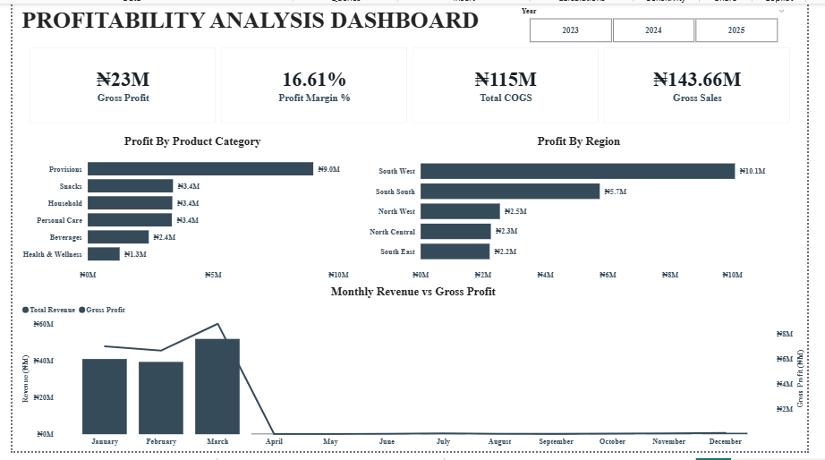
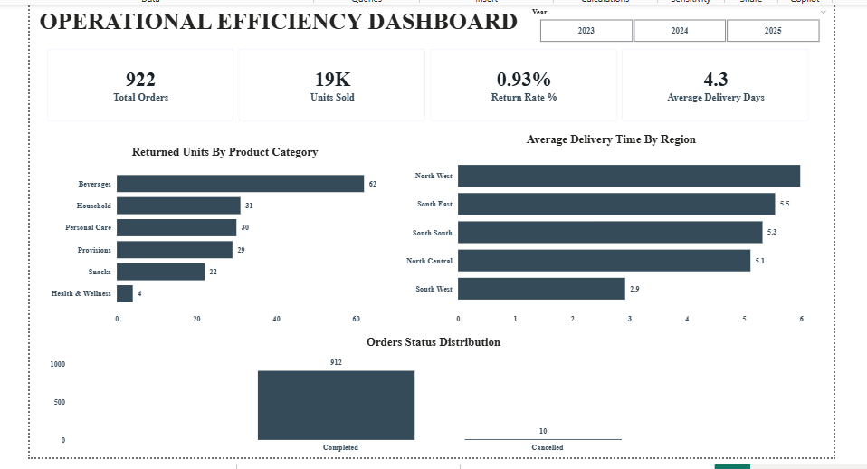

# Sales Performance, Profitability and Operational Efficiency Analysis (2023–2025)

## Project Overview

This project analyzes sales transactions from 2023 to 2025 to evaluate revenue performance, profitability, regional and product contributions, and operational efficiency.

Using Microsoft Excel, Power Query, Power BI, and DAX, I cleaned and validated the dataset, built a relational data model, and developed three interactive dashboards to support business decision-making.

## Business Objectives

- Evaluate revenue, order volume, and sales trends.
- Identify the highest-performing regions and product categories.
- Assess gross profit, profit margins, and cost of goods sold.
- Analyze product returns, delivery times, and order completion.
- Identify data-quality issues and provide actionable business recommendations.

## Tools Used

- **Microsoft Excel:** Data cleaning, validation, financial reconciliation checks, and cleaning-log documentation.
- **Power Query:** Data transformation, data-type correction, and safe conversion of invalid values.
- **Power BI:** Data modelling, interactive visualizations, and dashboard development.
- **DAX:** KPI calculations and analytical measures.

## Dataset and Data Preparation

The sales dataset contains **2,599 transaction rows**.

The data model includes sales, customer, product, and calendar tables, connected through one-to-many relationships.

### Data Cleaning and Quality Assurance

Data preparation included:

- Standardizing inconsistent region, category, and order-status values.
- Validating customer and product identifiers.
- Identifying **3 invalid order dates** and **4 invalid discount values**.
- Creating safe date and discount fields for Power BI analysis.
- Investigating data-type errors and correcting Power Query transformations.
- Identifying discrepancies in selected financial calculations.
- Retaining flagged records instead of silently deleting them.
- Verifying that order-status values were consistent within each order.

### Cleaning Log and Audit Trail

The cleaning log and supporting validation columns are maintained within **`Sales_Analysis_Ready.xlsx`**.

The workbook documents data-quality checks, cleaning actions, and records requiring additional review.

The invalid order dates were associated with Row_ID values **496, 1437, and 2192**, while the invalid discount values were associated with Row_ID values **567, 584, 1248, and 1943**.

Financial discrepancies were flagged for review rather than automatically treated as resolved. Original values were preserved where possible to support transparency and traceability.

## Dashboard 1 — Executive Sales Overview

This dashboard presents key sales indicators, monthly revenue trends, and performance across regions and product categories.

**Key metrics:**

- Total realized revenue: approximately **₦135.03 million**
- Total orders: **922**
- Units sold: approximately **19,000**
- Average order value: approximately **₦146,000**

The South West region and Provisions category generated the highest revenue, at approximately ₦60 million each.

Sales records were heavily concentrated in 2023, consistent with the original dataset.

## Dashboard 2 — Profitability Analysis

This dashboard examines recorded gross profit, profit margin, COGS, and profitability by product category and region.

**Key metrics:**

- Recorded gross profit: approximately **₦23 million**
- Recorded profit margin: **16.61%**
- Total COGS: approximately **₦115 million**
- Gross sales: approximately **₦143.66 million**

Provisions generated approximately ₦9 million in recorded gross profit, while South West generated approximately ₦10.1 million.

## Dashboard 3 — Operational Efficiency

This dashboard evaluates order fulfilment, delivery performance, product returns, and order statuses.

**Key metrics:**

- Return rate: **0.93%**
- Average delivery time: **4.3 days**
- Completed orders: **912**
- Cancelled orders: **10**

North West recorded the longest average delivery time at **6.0 days**, compared with **2.9 days** in South West.

Beverages had the highest returned quantity, with **62 units**.

A validation check found **zero orders with conflicting status values**.

## Business Recommendations

1. Investigate delivery delays in North West and assess logistics improvements.
2. Examine the causes of product returns, particularly in Beverages.
3. Sustain the strong performance of Provisions and South West while exploring opportunities in other segments.
4. Investigate the substantial difference in sales activity between 2023 and subsequent years, considering possible differences in dataset coverage.
5. Strengthen financial validation and reconciliation procedures for transactions flagged during cleaning.

## Data Limitations

The dataset contains invalid dates, invalid discounts, and financial discrepancies requiring review.

The analysis uses realized net sales for the revenue KPI and recorded gross profit for profitability reporting. These measures have different definitions and should not be treated as directly interchangeable.

The unequal distribution of transaction records across 2023–2025 limits straightforward year-over-year comparisons.

## Project Files

- `README.md` — Project documentation
- `Sales_Analysis_Ready.xlsx` — Cleaned dataset, cleaning log, and audit information
- `Sales_Performance_Dashboard.pbix` — Interactive Power BI report
- `Dashboard_Screenshots/` — Screenshots of the three dashboards

## Conclusion

This project demonstrates an end-to-end data analytics workflow, including data cleaning, quality assurance, relational modelling, DAX calculations, dashboard development, and business recommendations.

The dashboards provide insights into sales performance, profitability, and operational efficiency while maintaining transparency about data-quality limitations.
